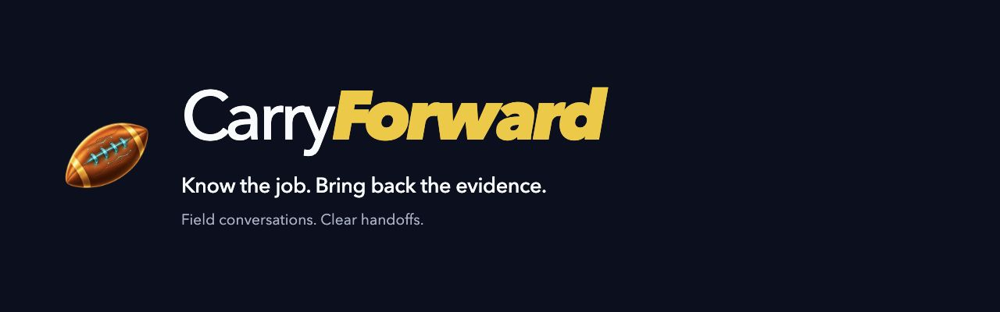

# CarryForward

**Arrive prepared. Bring back the evidence. Carry the next step forward.**



[](https://github.com/Andy-Barrett/carryforward/actions/workflows/checks.yml?query=branch%3Acodex%2Fcontest-demo-20261104)
[](https://nodejs.org/)
[](LICENSE)

CarryForward is a field-visit assistant for solar service teams. It brings the work order into a simple conversation, helps identify missing evidence, and returns a reviewable closeout with unfinished obligations and their owners intact.

Built for the **Meta Global AI Developer Hackathon**, starting October 30, 2026. This branch contains the company-Pilot application source used for the November 4 recorded phone walkthrough, with the polished presentation retained from public main. [Review the demonstrated behavior](docs/REVIEWER_GUIDE.md) or [run the local prototype](#try-it-locally).

The application snapshot is pinned to `617bc4e22b9038e69e3927cc9944c4861d841017`; this branch does not import its unchecked development history. The video shows a fictional assignment briefing, contextual equipment/access answers and a request for specific evidence after a generic completion statement. Its completed-handoff evidence comes from the **separate November 3 development trial** described below. [Snapshot scope and verification](docs/CONTEST_DEMO_SNAPSHOT.md) distinguish the two. The public main branch and its presentation remain intact.

## The problem

I run a solar company. When a technician returns from a visit, the office needs what they found, what they did, what they measured and what we still owe the customer.

Repair, production, monitoring and warranty paperwork are different outcomes. A useful handoff keeps them separate, even when the technician corrects a detail or cannot verify a result.

— Andy Barrett

## One visit, four steps

1. **Arrive prepared.** Read or hear the assignment, recent history, access notes and supplied sources. Ask a question about the job.
2. **Talk through the visit.** Hold to speak and release for a reply when providers are configured. Text remains available; photos are optional and stay job-scoped.
3. **Resolve what matters.** Correct a reading, answer a useful follow-up, or leave a check open with an explicit owner. Original testimony stays traceable.
4. **Carry it forward.** Review and confirm the report. Deliver it through the local API, then record source receipt and separate acceptance of that exact revision.

Work-order answers are context, not field testimony. Machine transcripts are marked unreviewed; final human report confirmation is a separate action. A confirmed report and an accepted handoff do not independently verify physical work.

## A correction that survives the handoff

In the November 3 owner-run fictional iPhone trial:

- A **4.2 kW** report was corrected to **2.4 kW, before work**.
- The amendment preserved the original words, reported monitoring and the report that no replacement was performed.
- **Production and warranty remained deferred to Operations**.
- The owner confirmed the report on the phone. HTTP delivery, source receipt and simulator acceptance applied to the same packet revision.
- Readback matched seven original voice files and eleven investigation events, including the correction links and both deferred owners.

The result was `accepted_with_followups`: the handoff arrived with its evidence and open work intact. Camera capture passed in a separate trial; no photo was part of this continuous visit.

See the [field-trial record](docs/FIELD_TRIAL_2026-11-03.md) and [physical-phone checks](docs/PHONE_VALIDATION.md).

## Where Meta fits

| Component | Role |
| --- | --- |
| `muse-voice-transcribe-1.0` | Transcribes newly submitted speech, linked to the original recording. |
| `muse-spark-1.3` | Interprets testimony and explicitly selected job images, proposes useful follow-ups and reconciles corrections. |
| Local application logic | Handles narrow source lookups, validates model references and changes, preserves evidence history, and binds confirmation to a revision. |
| ElevenLabs Sarah | Supplies spoken replies when configured. Speech output is separate from Meta interpretation. |

Provider calls are server-side, explicitly configured and bounded by the development guard. Existing recordings and photos are not implicitly sent. The current conversation uses sequential hold/release requests, not full-duplex streaming.

## Try it locally

Requires **Node.js 24**. There is no web build step.

```sh
git clone --branch codex/contest-demo-20261104 https://github.com/Andy-Barrett/carryforward.git
cd carryforward
npm ci --ignore-scripts
node pilot/server.mjs
```

Open [http://127.0.0.1:4430/pilot/](http://127.0.0.1:4430/pilot/). The server listens locally. Create a fresh fictional account/company and follow the [company-Pilot guide](docs/COMPANY_PILOT.md) to approve source versions and assign work. The recorded phone's private account, runtime job packet, provider configuration and saved evidence are intentionally absent.

Default startup makes no inference calls. Voice and model review require explicit development configuration; see [guarded Meta development](docs/META_DEVELOPMENT.md) and the Pilot guide. To explore the earlier single-user Dev prototype instead, run `npm run dev` and open `http://127.0.0.1:4310/`; that route retains four fictional assignments and text controls under **More**.

```sh
npm test
```

The archived Pilot source passed **375 checks with zero failures** in the offline release verification; three manufacturer-original acceptance tests were intentionally skipped because those private originals are excluded. The separate November 3 Dev checkpoint passed 189 checks. See [snapshot verification](docs/CONTEST_DEMO_SNAPSHOT.md) and [storage verification](docs/LOCAL_STORAGE_VERIFICATION.md).

## Scope and current limits

- **Working locally:** fictional assignments, source-tagged briefing, job-scoped photos/audio, correction history, owned deferrals, report confirmation and a persistent Operations simulator.
- **Observed on iPhone:** a bounded owner-run conversation and exact-revision closeout; camera, background and server-unavailable recovery have separate documented passes.
- **Still under evaluation:** broader interruptions, storage failure, browser eviction, iPhone Safari and Android. No independent technician study, accuracy advantage or measured time saving is claimed.
- **Company Pilot in this snapshot:** company accounts, scoped assignments and approved source versions are included. The recorded mobile session demonstrates conversation; mobile reliability remains under evaluation. No hosted production service is provided.
- **Safety boundary:** source context does not certify equipment safety or compliance; applicable approved procedures remain necessary.

Demo records are fictional. Local browser storage is not a portable backup; clearing it removes local records. Use the available exports and consult the documented recovery limits.

## Built during the event

Andrew supplied the field workflow and tested the phone experience. **Codex** prepared the prototype, coordinated and reviewed development, and implemented later investigation, Meta integration, simulator, voice and native layers. **Muse Code**, using `muse-spark-1.3`, contributed the initial durable job/photo sessions, evidence links, media export and revision-bound confirmation.

The football artwork was refined with built-in image generation; the wordmark remains live text.

The [development record](docs/DEVELOPMENT_LOG.md) separates coding assistance from actual product calls and retains failures that informed the current behavior.

## Explore the implementation

- [Simple conversation](docs/SIMPLE_VISIT.md) · [Voice path](docs/LIVE_VOICE.md) · [Photo review](docs/PHOTO_REVIEW_COPIES.md)
- [Local Operations API](docs/OPERATIONS_API.md) · [Architecture](docs/ARCHITECTURE.md) · [iPhone development app](ios/README.md)
- [Evaluation findings](docs/EVALUATION_FIRST_PASS.md) · [Readiness](docs/READINESS_REVIEW.md) · [Contest scope](docs/CONTEST_SCOPE.md)
- [Contributing](CONTRIBUTING.md) · [Security](SECURITY.md)

## License

[MIT](LICENSE). See [dependency notices](THIRD_PARTY_NOTICES.md). Provider services and generated speech retain their own terms.
