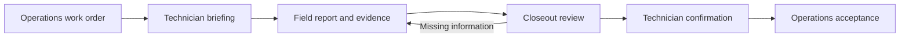

# CarryForward

**Know the job. Bring back the evidence.**

CarryForward helps field technicians arrive prepared and bring back a useful service report. It starts with the work order, keeps the requested work in view, and checks the closeout for missing observations and unfinished commitments.

## Why I’m building it

I run Perihelion Solar. When a technician finishes a service visit, the office needs more than “it’s fixed.” We need to know what they found, what they did, what they measured, and what we still owe the customer.

Replacing an inverter, confirming production, restoring monitoring, and sending warranty paperwork are separate pieces of work. A good report keeps those distinctions clear. It also gives the technician a chance to fill in missing information while they’re still at the site.

That’s the job I want CarryForward to do.

— Andy Barrett

## The field workflow

1. **Get the briefing.** Review the customer, property, system, reported problem, previous notes, and assigned scope.
2. **Record the visit.** Capture findings, work performed, dated observations, evidence references, and promises made to the customer.
3. **Review the closeout.** See which assigned checks have supporting information and which need another answer or follow-up.
4. **Hand it back.** Confirm the technician’s report and export it for Operations review. Unfinished work stays visible.



The current prototype uses file import and export. The diagram shows the intended responsibility of each step; it does not imply a live Operations connection.

## Try it locally

You need **Node.js 24**. There are no runtime dependencies to install.

```sh
git clone https://github.com/Andy-Barrett/carryforward.git
cd carryforward
npm run dev
```

Open **http://127.0.0.1:4310/**. The server listens only on your computer.

Start with the included fictional work order. Record a repair, leave production or monitoring unverified, and open the closeout review. Confirming the report keeps those open items in the exported handoff.

To use another port:

```sh
PORT=4311 npm run dev
```

Run the checks:

```sh
npm test
```

## What works today

- Work-order briefing with site and system identifiers, assigned scope, and source history.
- Validated JSON work-order import and a downloadable sample.
- Field reporting against individual work-order checks.
- Browser-local draft storage.
- Rule-based review for missing notes, evidence references, observation times, and follow-up ownership.
- Technician confirmation and JSON closeout export, including unresolved items.
- Responsive layouts checked at desktop and phone widths.

An evidence reference is a technician’s reference to a record; the app does not yet inspect the referenced file. “Documented” means the required information is present, not that the underlying work has been independently verified.

## Where we’re taking it

The target is a short conversation, not a longer form. A technician should be able to describe the visit naturally, refer to a job photo, correct a detail, and get one useful follow-up. Each new answer or image updates the investigation. Unresolved work stays visible without asking the same question over and over.

Communication style can be direct or conversational, with room for a little humor. The evidence requirements stay the same. That behavior is planned; the current interface is the working form-based foundation.


The next milestone is phone capture: photos, voice notes, and reliable local drafts. Meta-backed review will compare the original assignment with the field evidence and ask focused follow-up questions. We’ll measure whether it catches meaningful omissions without creating unnecessary work for the technician.

An installable web app for iPhone and Android is the delivery target. Live inference, media capture, offline attachments, and authenticated Operations integration are not implemented yet.

See the [contest scope](docs/CONTEST_SCOPE.md), [build plan](docs/BUILD_PLAN.md), and [technical notes](docs/ARCHITECTURE.md). Developers should start with [AGENTS.md](AGENTS.md) and the [Muse Code handoff](docs/MUSE_HANDOFF.md).

## Integration direction

CarryForward is a separate product from Perihelion Operations and PRISM. A system that assigns work should be able to supply a work order and receive a structured closeout. The originating system retains responsibility for accepting the report and completing its own work order.

The current JSON format is a prototype contract, not an existing Operations API. You can download its sample from the app. Authenticated endpoints, delivery notifications, and retry handling are planned.

## Development status and data

This is an early prototype built for the **Meta Global AI Developer Hackathon**, starting October 30, 2026. It began as a business-transition concept and was narrowed to field operations before model integration. The current review is deterministic; no AI inference runs in this version.

The demonstration records are fictional. No Perihelion customer records or application source were copied into this repository. Use synthetic data while developing and testing. Keep credentials, customer records, and field evidence out of Git and issue reports.

Drafts stay in this browser. Confirmation stays in memory until export, so download the closeout to retain it. Reloading requires another review and confirmation.

For development guidance, see [CONTRIBUTING.md](CONTRIBUTING.md). For security concerns, see [SECURITY.md](SECURITY.md).
