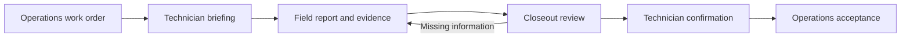

# CarryForward

**Know the job. Bring back the evidence.**

CarryForward helps field technicians arrive prepared and bring back a useful service report. It starts with the work order, keeps the requested work in view, and checks the closeout for missing observations and unfinished commitments.

## Why I’m building it

I run Perihelion Solar. When a technician finishes a service visit, the office needs more than “it’s fixed.” We need to know what they found, what they did, what they measured, and what we still owe the customer.

Replacing an inverter, confirming production, restoring monitoring, and sending warranty paperwork are separate pieces of work. A good report keeps those distinctions clear. It also gives the technician a chance to fill in missing information while they’re still at the site.

That’s the job I want CarryForward to do.

— Andy Barrett

## The field workflow

1. **Get the briefing.** Review the customer, property, system, reported problem, previous notes, and assigned scope.
2. **Record the visit.** Capture findings, work performed, dated observations, evidence references, and promises made to the customer.
3. **Review the closeout.** See which assigned checks have supporting information and which need another answer or follow-up.
4. **Hand it back.** Confirm the technician’s report and export it for Operations review. Unfinished work stays visible.



The prototype supports file import/export and a local Operations simulator with HTTP assignment, evidence, handoff, receipt and acceptance endpoints. It has no live Perihelion connection.

## Try it locally

You need **Node.js 24**. Install the locked WebSocket dependency before starting. There is no web build step.

```sh
git clone https://github.com/Andy-Barrett/carryforward.git
cd carryforward
npm ci --ignore-scripts
npm run dev
```

Open **http://127.0.0.1:4310/**. The server listens only on your computer.

Start with the included fictional work order. Record a repair, leave production or monitoring unverified, and open the closeout review. Confirming the report keeps those open items in the exported handoff.

To use another port:

```sh
PORT=4311 npm run dev
```

Run the checks:

```sh
npm test
```

## What works today

- A cloud conversation as the main workspace, with on-demand job sources, PDF-page inspection and a hidden type fallback. See the [cloud interface](docs/CLOUD_INTERFACE.md) for command examples and current document/voice limits.
- A pre-visit brief covering system/problem, planning ideas, customer preferences, access and explicit safety/ladder source gaps, with source metadata and on-demand recall. See [pre-visit briefing](docs/PRE_VISIT_BRIEF.md).
- Work-order briefing with site and system identifiers, assigned scope, and source history.
- Validated JSON work-order import and a downloadable sample.
- Field reporting against individual work-order checks.
- Browser-local drafts, saved interviews, correction history and explicit deferrals. Unsent interview text, corrections and reviewed voice links recover per job; Save answer commits the turn and clears its draft together.
- Local voice clips and playback, optional guarded Meta transcription of synthetic clips, and reviewed transcript-to-answer links. The new [live voice slice](docs/LIVE_VOICE.md) adds a local microphone check, streaming ASR and a reviewed-Send/spoken-follow-up path; the owner confirmed the speech → reviewed Send → spoken follow-up loop on iPhone on November 1.
- Rule-based review for missing notes, evidence references, observation times, and follow-up ownership.
- Technician confirmation and JSON closeout export, including unresolved items.
- Local Operations API and persistent simulator inbox with original evidence bytes, explicit receipt and exact-revision acceptance.
- Responsive layouts checked at desktop and phone widths.

A typed evidence reference is a technician’s reference to a record; the completeness checker does not inspect an arbitrary referenced file. Optional Meta review inspects only explicitly selected saved job images. The interview previews originals and can prepare smaller, explicitly labeled review copies without replacing them. Copies retain the original ID/hash through export and handoff. See [review-copy details and limits](docs/PHOTO_REVIEW_COPIES.md). “Documented” means the required information is present, not that the underlying work has been independently verified.

## Where we’re taking it

The target is a short conversation, not a longer form. A technician should be able to describe the visit naturally, refer to a job photo, correct a detail, and get one useful follow-up. Each new answer or image updates the investigation. Unresolved work stays visible without asking the same question over and over.

Communication style can be direct or conversational, with room for a little humor. The evidence requirements stay the same. An explicit direct/conversational preference now saves with each job and controls future Meta review wording. Automatic preference learning remains planned; no accuracy benefit has been established. The saved interview preserves answers, corrections and deferrals, with optional guarded Meta interpretation and a form for final review.


Photo attachments now persist locally in IndexedDB, with job-scoped links and a bounded media export. Voice recording controls and guarded transcription are implemented. On October 31, the owner confirmed audible playback of an existing clip and a fresh record/stop/play cycle in the native iPhone development app. One Home/background interruption preserved an audible partial clip, and native build 4 opened the saved visit with the private server stopped. Other interruption routes and new offline recording remain unverified. Meta-backed review compares the original assignment with field evidence and proposes focused follow-up questions. The first synthetic comparison preserved expected outcomes but did not establish an accuracy advantage over a strong same-model summary. See [evaluation findings](docs/EVALUATION_FIRST_PASS.md).

An installable web app for iPhone and Android is the delivery target. Voice capture controls and uploaded-audio transcription are implemented; the basic record/stop/play cycle is owner-confirmed in the native iPhone development app. Safari/Android capture and interruption behavior remain unverified. A versioned app shell now supports offline reopening after successful initial installation; server-stopped browser reload and local answer persistence were verified. Native iPhone development installation is verified; web-app installation and airplane-mode behavior remain unverified. Production Operations integration remains unimplemented. The local simulator uses same-origin session authentication and separate acceptance of exact handoff revisions. Meta review is available behind the explicit guarded development configuration; the first bounded live phone turn and spoken follow-up are owner-confirmed; full-duplex conversation and broader phone acceptance remain incomplete.

See [guarded Meta development](docs/META_DEVELOPMENT.md) for the local inference boundary.

See the [readiness review](docs/READINESS_REVIEW.md), [contest scope](docs/CONTEST_SCOPE.md), [build plan](docs/BUILD_PLAN.md), and [technical notes](docs/ARCHITECTURE.md). Developers should start with [AGENTS.md](AGENTS.md) and the [Muse Code handoff](docs/MUSE_HANDOFF.md).

## Integration direction

CarryForward is a separate product from Perihelion Operations and PRISM. A system that assigns work should be able to supply a work order and receive a structured closeout. The originating system retains responsibility for accepting the report and completing its own work order.

The JSON format is a prototype contract, not an adopted Perihelion API. The local simulator now accepts assignments and evidence, exposes an Operations inbox, and records receipt and acceptance separately. Retries are idempotent for identical assignments and queued report revisions; changed scope or stale revisions are rejected. See [local Operations API](docs/OPERATIONS_API.md).

## Development status and data

This is an early prototype built for the **Meta Global AI Developer Hackathon**, starting October 30, 2026. It began as a business-transition concept and was narrowed to field operations before model integration. The base completeness review is deterministic. Optional server-side Meta review now interprets saved synthetic testimony and selected job images through the approved aggregate spending guard; it remains disabled unless explicitly configured.

The demonstration records are fictional. No Perihelion customer records or application source were copied into this repository. Use synthetic data while developing and testing. Keep credentials, customer records, and field evidence out of Git and issue reports.

Drafts and photo attachments stay in this browser. IndexedDB stores job sessions, photo bytes, events and revision-bound confirmations; the active text draft also uses localStorage. Export the closeout/media bundle to retain a portable copy. Clearing browser storage removes local records. This is a prototype: storage conflicts, quota recovery and physical phone behavior still need validation.

For development guidance, see [CONTRIBUTING.md](CONTRIBUTING.md). For security concerns, see [SECURITY.md](SECURITY.md).

A private [iPhone development target](ios/README.md) now reuses this web app through SwiftUI/WKWebView. The app renders the brief and visit workspace in an iPhone Air simulator. An owner-approved Personal Team build now loads the current briefing on the physical iPhone through the paired private HTTPS service. We have now run one fictional visit on the iPhone through live speech, a camera photo, Meta review and an API handoff to the local test inbox. Both photos and the voice clip arrived intact, with four follow-ups still open. A Home/background recording and server-stopped cold startup now have bounded iPhone passes. The remaining interruption, offline recording/reconnect and Android checks are still open. See the [phone results](docs/PHONE_VALIDATION.md).
