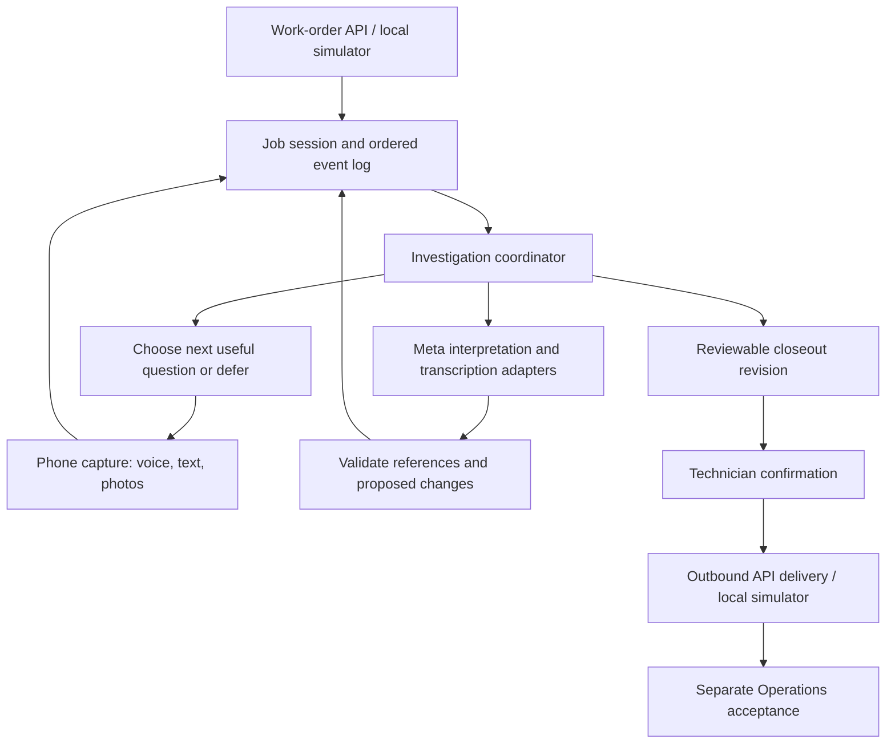

# Technical notes

## Current implementation

CarryForward is a small browser application served by Node’s built-in HTTP server. It has no framework, build step or runtime package dependencies. The local Operations simulator uses Node 24 built-in SQLite under ignored `.local/`; browser drafts and attachments remain in IndexedDB.

| File               | Responsibility                                                                        |
| ------------------ | ------------------------------------------------------------------------------------- |
| `server.mjs`       | Serve an explicit allowlist of application files on loopback                          |
| `public/app.js`    | Briefing, report capture, local draft storage, review, confirmation, and export       |
| `public/engine.js` | Work-order validation, evidence-completeness rules, confirmation, and export envelope |
| `public/style.css` | Desktop and phone layouts                                                             |
| `engine.test.mjs`  | Focused domain checks using Node’s test runner                                        |

## Work-order input

`carryforward.work-order.v1` includes the source work-order ID, customer and property labels, system ID, reported issue, requested work, dated history, and individual closeout checks. Download the sample from the app to inspect the full format.

The validator requires nonempty bounded text, limits the number of work items and checks, and rejects duplicate check and history IDs. Browser import limits the file to 100 KB. This is a local prototype format; it has not been adopted as a Perihelion Operations contract.

## Review behavior

Each check records a status, observation or explanation, evidence reference, and observation time.

- **Documented:** an observed result includes a note, reference, and parseable observation time. This is a completeness check, not independent verification of the source.
- **Reported:** a source-linked interview branch supports a narrow technician claim. It is not independently verified or silently upgraded to a measured observation.
- **Open:** the check is pending, deferred, contradicted or unverified, or required supporting information is missing.
- **Exception:** the technician supplies a not-applicable explanation. Operations still needs to review it.

The engine reviews each check independently. A documented repair cannot resolve production, monitoring, or warranty checks by implication. New customer commitments and open work require a follow-up owner; an absent owner is flagged.

Technician confirmation records a name and timestamp. It is an attestation within this prototype, not authenticated identity or an electronic signature. The Operations status remains `Awaiting Operations acceptance`.

## Persistence and export

The work order and field draft use the browser’s `localStorage` under `carryforward.field.v1`. They are local to this browser and origin. IndexedDB holds job sessions, ordered events, photo blobs and revision-bound confirmations. Importing another work order preserves saved jobs. Active text drafts also use localStorage; multi-tab conflict resolution remains unimplemented.

The JSON download contains the validated work order and `carryforward.closeout.v1` report together. It preserves original history, individual findings, open items, new commitments, and confirmation when present. No report is sent to a provider or Operations.

## Limits to address before operational use

There is no production user authentication or multi-user access control. The loopback simulator persists admitted records and evidence bytes, and guarded Meta review is opt-in. Source receipt and acceptance are local simulation, not a live Perihelion connection. Browser storage is not a backup. Observation times entered through the form use the device’s local time without an explicit timezone in the current export; cross-system use needs an offset-aware timestamp contract.

Phone-width layout checks have been performed. Physical-device camera, microphone, installability, and offline behavior still need implementation and testing.

## Model and integration direction

Keep the assignment, technician testimony, source evidence, model findings, and human acceptance distinct. Model-generated findings must refer to admitted records, and malformed or unsupported output must remain incomplete rather than silently closing work.

API secrets belong on the server. The planned integration boundary accepts work orders and returns closeouts using stable external IDs. Authentication, duplicate handling, retries, and explicit acceptance must precede live Operations synchronization.

## Target architecture: one job, an evidence-driven loop

The sections above describe the current implementation. Everything below is a target design, not an existing service or accepted Operations contract.

### Keep the prototype small

Retain a single Node backend and browser client initially. Add domain modules for sessions, evidence, investigation, and adapters; do not introduce a workflow service, vector database, per-question agents, or PRISM dependency to finish the contest.

Use IndexedDB for phone drafts and media. Use a local SQLite store for admitted sessions/events and media metadata, with blobs in an ignored application-data directory. Node 24's SQLite API is a candidate to verify during implementation; do not introduce an ORM or production migration for this prototype. Browser-local save and server admission are distinct states. A blob is admitted only after the server acknowledges its identity and hash.

### Domain records

| Record | Required distinction |
| --- | --- |
| Assignment | Source system, external job/site/system IDs, scope, revision, source history, authority |
| Evidence | Stable ID, job/session ID, content hash, type, capture/upload times, origin, local/server availability |
| Observation | Claim, equipment/site identity, observed time with UTC offset, source evidence or testimony |
| Investigation branch | Question, related assignment item, supporting/contradicting evidence, state, owner, reopening reason |
| Interview turn | Ordered utterance/transcript, speaker, correction/supersession reference, interruption state |
| Interpretation | Model/provider/version, input evidence IDs, output schema version, usage, validation result |
| Closeout | Revision, included evidence/events, supported/unknown outcomes, commitments, technician confirmation |
| Acceptance | Originating-system decision referring to the exact closeout revision; separate from receipt |

Names and serial strings are not canonical identity. Carry source IDs through the adapter without merging jobs or people based on labels alone. Each idempotency key is scoped to its integration and operation, not global across callers.

### Investigation cycle

1. Persist incoming evidence or a turn with a stable event ID and monotonically increasing session sequence.
2. Assemble bounded context from the assignment, admitted evidence, open branches, and confirmed communication preferences.
3. Ask the model for proposed observations, branch changes, and at most one next question. Output includes exact evidence references and a reason for material changes.
4. Validate the output schema, job ownership of references, quoted passages when applicable, and whether a model result still matches the input session revision.
5. Append accepted changes, retaining prior evidence and corrected interpretations. Do not let stale results overwrite newer human answers. Reconcile again only when there is new material input and budget remains.
6. Ask, defer, assign, or stop. A missing observation may remain explicitly unknown; no model can reason it into existence.

Branch states: `open`, `supported`, `contradicted`, `needs_verification`, `deferred`. Supported means support for a defined claim, not universal repair or safety verification. Reopen only for material new evidence, a correction, or an assignment revision; record why.

Model context is a bounded projection of stored records, not the authoritative job record. Repeated reasoning without new evidence is not verification.

### Question policy

Prioritize material questions whose answers can change an outcome and are easiest to obtain now. An onsite-only measurement outranks an office paperwork lookup. Hold routine questions until the technician finishes speaking. Capture a mid-response interruption as a new turn; cancel obsolete spoken output and keep the unsaid portion distinct from what the user heard.

Start with configurable ceilings of one active question, three proactive follow-ups per review pass, and one automatic retry for a transient provider error. These are proposed defaults, not observed optimums. A technician may choose to continue. Reaching a limit produces an incomplete/deferred handoff, never a fabricated completion.

`Already answered`, `can't verify`, and `follow up later` update branch state. Do not repeatedly ask equivalent questions without new evidence. Final review exposes material unresolved items, exceptions, and unassigned commitments.

### Style and memory

Company requirements, technician preferences, and job facts are separate scopes. Begin with explicit style and detail settings plus session-local vocabulary corrections. Do not infer personality traits, competence, or risk tolerance. Later preference suggestions need provenance, user confirmation, edit/reset controls, and bounded retention.

Humor affects wording, not truth standards or procedure requirements. Use responsive brief humor, not compulsory banter. Safety instructions come from approved applicable procedures and explicit rules. Web-discovered documents are candidates requiring provenance and applicability checks; they do not silently become approved instructions.

### Meta adapters and usage control

Use server-side adapters for transcription and multimodal interpretation. Choose actual model IDs, request formats, media limits, retention settings, and prices from verified Meta documentation at integration time. Keep contributor/training mode off for coding and product use.

The server owns credentials, per-request input/output limits, per-session call/token budgets, timeouts, and accounting. Reserve a conservative maximum cost before dispatch, including model-assisted retries or tool-review calls, then reconcile actual usage. Disable further dispatch if budget or price information cannot be established. A billing notification is not a hard cap.

No model call is authorized until the owner confirms posted credits and a bounded run. Test adapters with synthetic recorded responses while disabled, clearly labeled as such. Do not claim a fixture proves live model behavior.

### Integration surface for the contest

Implement and document a small versioned HTTP boundary:

- `POST /api/v1/work-orders`: admit a source assignment using integration-scoped idempotency and external IDs.
- `GET /api/v1/jobs/:jobId`: return a bounded status and revision.
- `POST /api/v1/jobs/:jobId/evidence`: admit bounded media/text; verify association and content hash.
- `POST /api/v1/jobs/:jobId/turns`: append a technician turn and schedule a bounded review when inference is enabled.
- `GET /api/v1/jobs/:jobId/closeout`: obtain a versioned reviewable result, including unresolved items.
- `POST /api/v1/jobs/:jobId/confirmations`: confirm a specific closeout revision. Reject stale revisions.

A local simulator polls for the closeout and records receipt and acceptance separately. It does not change Perihelion. Webhooks, production authentication and tenant isolation follow after the bounded demo. Demo endpoints still require explicit local authentication and must not be exposed publicly without a hosted-access review. Do not forward arbitrary supplied callback URLs.

### Offline behavior and recovery

A photo or recording moves through `saving_local`, `saved_local`, `pending_upload`, `admitted`, and optionally `failed`. Show the actual state; never call local media synced. Preserve the immutable original alongside corrected transcripts and generated derivatives. Duplicate retries must not create new evidence or jobs.

Network loss does not prevent local capture of an already opened job. AI review requires admitted evidence and connectivity. A service worker can cache the app shell later; do not claim fresh offline startup before it is tested. Browser eviction, permission refusal, storage exhaustion, recorder interruption, and unsupported image formats need visible recovery paths.

Photo inspection and final confirmation are parked activities. No continuous driving interview, background camera collection, full-library access, or glasses dependency.

## Investigation implementation checkpoint

`public/investigation.js` and `investigation.test.mjs` implement the pure job projection and interpretation validator described above. Source admission, correction history, excluded support, explicit human deferral/reopening, bounded follow-ups and branch/evidence-based question suppression are implemented in the module. The UI still uses the original completeness engine; no live provider or interview integration is claimed. Test model names explicitly identify synthetic fixtures.
