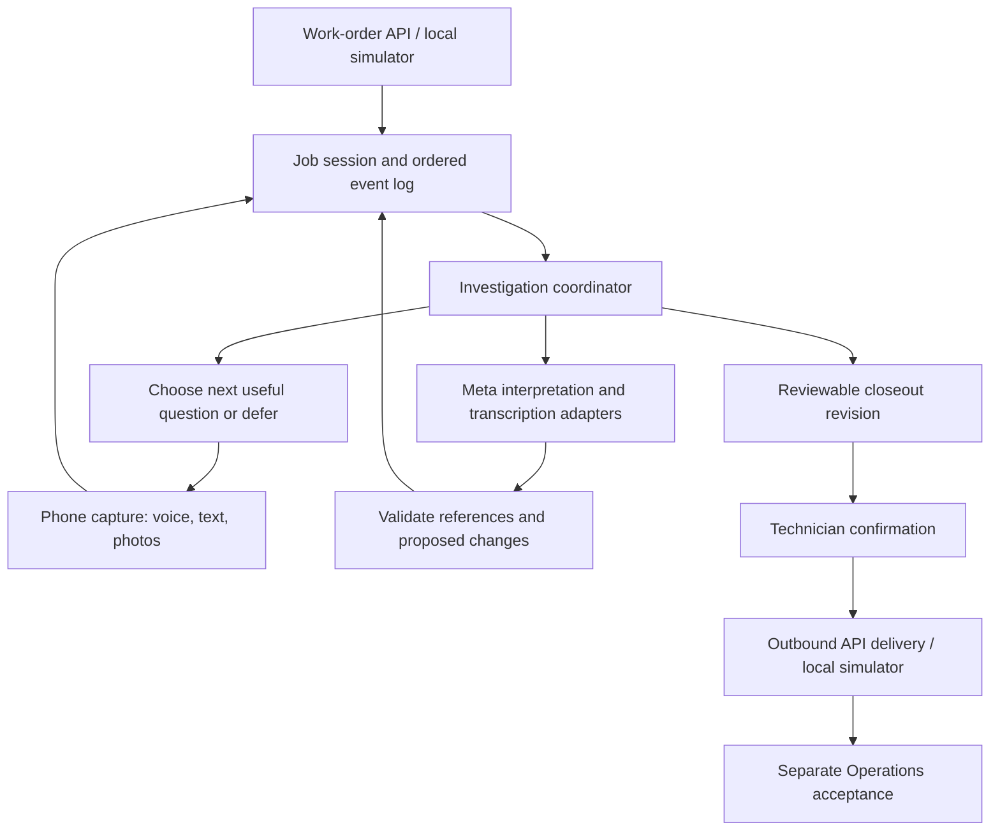

# Technical notes

## Current implementation

CarryForward is a small browser application served by Node’s built-in HTTP server. It has no framework or web build step. The exact locked MIT-licensed `ws` package supplies the bounded WebSocket relay. The local Operations simulator uses Node 24 built-in SQLite under ignored `.local/`; browser drafts and attachments remain in IndexedDB.

| File               | Responsibility                                                                        |
| ------------------ | ------------------------------------------------------------------------------------- |
| `server.mjs`       | Serve an explicit allowlist of application files on loopback                          |
| `public/app.js`    | Briefing, report capture, local draft storage, review, confirmation, and export       |
| `public/engine.js` | Work-order validation, evidence-completeness rules, confirmation, and export envelope |
| `public/style.css` | Desktop and phone layouts                                                             |
| `public/interview.js`, `public/investigation.js` | Saved interview, explicit preferences, evidence loop and bounded proposal validation |
| `public/jobstore.js` | IndexedDB sessions, events, media and separate unsent drafts |
| `public/held-voice.js` | Gesture-owned local PCM capture, one submission on release and cancellation/interruption handling |
| `ios/CarryForward/PhoneConnection.swift` | Origin-scoped Keychain credential, TLS-verified session renewal and native cookie handoff |
| `public/live-voice.js`, `public/pcm-worklet.js`, `lib/live-transport.mjs` | Local input preflight, bounded live ASR and authenticated guarded relay; see [live voice](LIVE_VOICE.md) |
| `public/local-speech.js`, `ios/CarryForward/VisitBrowser.swift` | Local spoken follow-up and native audio-session lifecycle |
| `public/voice.js`, `public/audio.js` | Local recording/playback, normalized transcription audio and reviewed transcript links |
| `public/review-copy.js` | Bounded JPEG copies with original-source provenance |
| `lib/meta-review.mjs`, `lib/meta-transcribe.mjs` | Guarded actual Meta interpretation/transcription adapters |
| `lib/operations*.mjs` | Persistent local simulator, byte admission and exact-revision handoff/acceptance |
| `public/sw.js`, `public/offline.js` | Versioned app-shell cache and actual service-connectivity status |
| `public/observation-time.js` | Offset-aware calendar validation and lossless form roundtrip |
| `*.test.mjs` | Node domain, guard and local HTTP integration checks |

## Work-order input

`carryforward.work-order.v1` includes the source work-order ID, customer and property labels, system ID, reported issue, requested work, dated history, and individual closeout checks. An optional `briefing` carries bounded source-tagged system/problem/planning/customer/access/safety/ladder notes. These remain assignment context rather than field evidence or procedure approval; see [pre-visit brief](PRE_VISIT_BRIEF.md). Download the sample from the app to inspect the full format.

The validator requires nonempty bounded text, limits the number of work items and checks, and rejects duplicate check and history IDs. Browser import limits the file to 100 KB. This is a local prototype format; it has not been adopted as a Perihelion Operations contract.

## Review behavior

Each check records a status, observation or explanation, evidence reference, and observation time.

- **Documented:** an observed result includes a note, reference, and valid calendar observation time with explicit UTC offset. This is a completeness check, not independent verification of the source.
- **Reported:** a source-linked interview branch supports a narrow technician claim. It is not independently verified or silently upgraded to a measured observation.
- **Open:** the check is pending, deferred, contradicted or unverified, or required supporting information is missing.
- **Exception:** the technician supplies a not-applicable explanation. Operations still needs to review it.

The engine reviews each check independently. A documented repair cannot resolve production, monitoring, or warranty checks by implication. New customer commitments and open work require a follow-up owner; an absent owner is flagged.

Technician confirmation records a name and timestamp. It is an attestation within this prototype, not authenticated identity or an electronic signature. Confirmation is separate from source receipt and Operations acceptance of the exact packet revision.

## Persistence and export

The work order and field draft use the browser’s `localStorage` under `carryforward.field.v1`. They are local to this browser and origin. IndexedDB holds job sessions, ordered events, photo/audio blobs, separate unsent interview drafts and revision-bound confirmations. Importing another work order preserves saved jobs. Active text drafts also use localStorage; multi-tab conflict resolution remains unimplemented.

The JSON download contains the validated work order and `carryforward.closeout.v1` report together. It preserves original history, individual findings, open items, new commitments, and confirmation when present. Downloading sends nothing to a provider or Operations. Explicit guarded review sends selected fictional evidence to Meta; explicit simulator delivery admits evidence bytes and queues a confirmed packet over the local HTTP API.

## Limits to address before operational use

There is no production user authentication or multi-user access control. The loopback simulator persists admitted records and evidence bytes, and guarded Meta review is opt-in. Source receipt and acceptance are local simulation, not a live Perihelion connection. Browser storage is not a backup. New form observations carry the displayed UTC offset. Legacy offset-free times remain unresolved until the technician supplies an offset; no historical timezone is inferred. Report creation times also require an explicit offset. The `carryforward.review.v5` confirmation contract prevents reuse of earlier completeness approvals.

Phone-width layout checks have been performed. Recording controls, the standalone manifest and offline shell are implemented. Native iPhone development installation, saved-clip playback and a fresh record/stop/play cycle are verified by installation receipts and owner testing. One fictional camera-original/copy and local API handoff pass is recorded on November 1. Permission-denial, interruption, airplane-mode and Safari/Android behavior remain unverified. Server-stopped desktop reopening and local persistence were verified; see `docs/OFFLINE.md` and `docs/PHONE_VALIDATION.md`.

## Model and integration direction

Keep the assignment, technician testimony, source evidence, model findings, and human acceptance distinct. Model-generated findings must refer to admitted records, and malformed or unsupported output must remain incomplete rather than silently closing work.

API secrets belong on the server. The local integration boundary accepts work orders and returns closeouts using stable external IDs. Authentication, duplicate handling, retries, and explicit acceptance must precede live Operations synchronization.

## Target architecture: one job, an evidence-driven loop

The diagram describes the accepted product architecture. The local evidence loop, adapters and simulator now implement its main path; physical-device validation, spoken responses, broader integrations and production access remain future work. See `docs/READINESS_REVIEW.md` for requirement-level evidence. This is not an adopted Perihelion contract.

### Keep the prototype small

Retain a single Node backend and browser client initially. Add domain modules for sessions, evidence, investigation, and adapters; do not introduce a workflow service, vector database, per-question agents, or PRISM dependency to finish the contest.

Use IndexedDB for phone drafts and media. The local SQLite store holds admitted sessions/events, evidence metadata and bytes under ignored `.local/`. Node 24’s SQLite API is implemented and tested; do not introduce an ORM or production migration for this prototype. Browser-local save and server admission are distinct states. A blob is admitted only after the server acknowledges its identity and hash.

### Domain records

| Record | Required distinction |
| --- | --- |
| Assignment | Source system, external job/site/system IDs, scope, revision, source history, authority |
| Evidence | Stable ID, job/session ID, content hash, type, capture/upload times, origin, local/server availability |
| Observation | Claim, equipment/site identity, observed time with UTC offset, source evidence or testimony |
| Investigation branch | Question, related assignment item, supporting/contradicting evidence, state, owner, reopening reason |
| Interview turn | Ordered utterance/transcript, speaker, correction/supersession reference, interruption state |
| Interpretation | Model/provider/version, input evidence IDs, output schema version, usage, validation result |
| Closeout | Revision, included evidence/events, supported/unknown outcomes, commitments, technician confirmation |
| Acceptance | Originating-system decision referring to the exact closeout revision; separate from receipt |

Names and serial strings are not canonical identity. Carry source IDs through the adapter without merging jobs or people based on labels alone. Each idempotency key is scoped to its integration and operation, not global across callers.

### Investigation cycle

1. Persist incoming evidence or a turn with a stable event ID and monotonically increasing session sequence.
2. Assemble bounded context from the assignment, admitted evidence, open branches, and confirmed communication preferences.
3. Ask the model for proposed observations, branch changes, and at most one next question. Output includes exact evidence references and a reason for material changes.
4. Validate the output schema, job ownership of references, quoted passages when applicable, and whether a model result still matches the input session revision.
5. Append accepted changes, retaining prior evidence and corrected interpretations. Do not let stale results overwrite newer human answers. Reconcile again only when there is new material input and budget remains.
6. Ask, defer, assign, or stop. A missing observation may remain explicitly unknown; no model can reason it into existence.

Branch states: `open`, `supported`, `contradicted`, `needs_verification`, `deferred`. Supported means support for a defined claim, not universal repair or safety verification. Reopen only for material new evidence, a correction, or an assignment revision; record why.

Model context is a bounded projection of stored records, not the authoritative job record. Repeated reasoning without new evidence is not verification.

### Question policy

Prioritize material questions whose answers can change an outcome and are easiest to obtain now. An onsite-only measurement outranks an office paperwork lookup. Hold routine questions until the technician finishes speaking. Capture a mid-response interruption as a new turn; cancel obsolete spoken output and keep the unsaid portion distinct from what the user heard.

Start with configurable ceilings of one active question, three proactive follow-ups per review pass, and no automatic provider retries. These are bounded defaults, not observed optimums. A technician may choose to continue. Reaching a limit produces an incomplete/deferred handoff, never a fabricated completion.

`Already answered`, `can't verify`, and `follow up later` update branch state. Do not repeatedly ask equivalent questions without new evidence. Final review exposes material unresolved items, exceptions, and unassigned commitments.

### Style and memory

Company requirements, technician preferences, and job facts are separate scopes. Direct/conversational style is now an explicit saved job preference. Detail settings and vocabulary suggestions remain future work. Do not infer personality traits, competence, or risk tolerance. Later preference suggestions need provenance, user confirmation, edit/reset controls, and bounded retention.

Humor affects wording, not truth standards or procedure requirements. Use responsive brief humor, not compulsory banter. Safety instructions come from approved applicable procedures and explicit rules. Web-discovered documents are candidates requiring provenance and applicability checks; they do not silently become approved instructions.

### Meta adapters and usage control

Use server-side adapters for transcription and multimodal interpretation. Choose actual model IDs, request formats, media limits, retention settings, and prices from verified Meta documentation at integration time. Keep contributor/training mode off for coding and product use.

The server owns credentials, per-request input/output limits, per-session call/token budgets, timeouts, and accounting. Reserve a conservative maximum cost before dispatch, including model-assisted retries or tool-review calls, then reconcile actual usage. Disable further dispatch if budget or price information cannot be established. A billing notification is not a hard cap.

The October 30 owner approval authorizes CarryForward code and fictional examples under a $10 aggregate guard shared by coding and product inference; it does not authorize customer evidence or new subscriptions. Test adapters with synthetic recorded responses while disabled, clearly labeled as such. Do not claim a fixture proves live model behavior.

### Integration surface for the contest

Implement and document a small versioned HTTP boundary:

- `POST /api/v1/work-orders`: admit a source assignment using integration-scoped idempotency and external IDs.
- `GET /api/v1/jobs/:jobId`: return a bounded status and revision.
- `POST /api/v1/jobs/:jobId/evidence`: admit bounded media/text; verify association and content hash.
- `POST /api/v1/jobs/:jobId/turns`: append a technician turn and schedule a bounded review when inference is enabled.
- `GET /api/v1/jobs/:jobId/closeout`: obtain a versioned reviewable result, including unresolved items.
- `POST /api/v1/jobs/:jobId/confirmations`: confirm a specific closeout revision. Reject stale revisions.

A local simulator polls for the closeout and records receipt and acceptance separately. It does not change Perihelion. Webhooks, production authentication and tenant isolation follow after the bounded demo. Demo endpoints still require explicit local authentication and must not be exposed publicly without a hosted-access review. Do not forward arbitrary supplied callback URLs.

### Offline behavior and recovery

A photo or recording moves through `saving_local`, `saved_local`, `pending_upload`, `admitted`, and optionally `failed`. Show the actual state; never call local media synced. Preserve the immutable original alongside corrected transcripts and generated derivatives. Duplicate retries must not create new evidence or jobs.

Network loss does not prevent local capture of an already opened job. AI review requires admitted evidence and connectivity. The implemented service worker caches only the content-versioned app shell. Server-stopped reopening was tested on desktop and the native iPhone. The owner also confirmed new local recording/playback with the private server stopped and retained audible playback after update/re-pairing; see `PHONE_VALIDATION.md`. Airplane-mode and browser-eviction behavior remain unverified. Browser eviction, permission refusal, storage exhaustion, recorder interruption, and unsupported image formats need visible recovery paths.

Photo inspection and final confirmation are parked activities. No continuous driving interview, background camera collection, full-library access, or glasses dependency.

## Investigation implementation checkpoint

`public/investigation.js` and `investigation.test.mjs` implement the pure job projection and interpretation validator described above. Source admission, correction history, excluded support, explicit human deferral/reopening, bounded follow-ups and branch/evidence-based question suppression are implemented in the module. The UI combines the completeness engine with the saved interview, actual guarded Meta review, source-linked findings and local Operations delivery. First-pass evaluation and development retests are documented in `docs/EVALUATION_FIRST_PASS.md`; they do not prove an accuracy advantage over a strong same-model summary. Test model names explicitly identify synthetic fixtures.

## Private iPhone development target

`ios/CarryForward.xcodeproj` now supplies a small SwiftUI/WKWebView shell over one explicit development origin. It retains the web evidence/API contracts, persistent origin-scoped storage and system TLS validation; it does not load bundled file:// HTML or implement a second investigation engine. Simulator and signed physical-device builds passed; the current brief renders on both. The owner confirmed saved-clip playback and a fresh record/stop/play cycle on the physical iPhone after an explicit native playback-session adapter. One assisted live voice/camera/local API handoff cycle passed on November 1; one Home/background interruption and server-unavailable cold-start/record/play/reconnect sequence subsequently passed. The wider capture/interruption matrix remains pending, with Android deferred by the owner on November 1. See [native build and owner checklist](../ios/README.md).

An optional handoff checkbox assigns every unresolved check to the named report owner. It emits `branches.owner-assigned`, preserving branch outcomes, evidence, question limits and earlier events. It advances the input/event revision, invalidates old confirmation/acceptance and leaves the packet needing review and confirmation. The handoff sheet lists current individual owners before the choice; leaving the box unchecked preserves them.

## November 2 conversation boundary

The main Cloud session now selects the hold-to-speak surface. `held-voice.js` acquires/resumes audio inside the press gesture, retains the first available PCM, releases microphone/context on stop and cancels on background/disposal. `voice.js` saves the WAV before provider dispatch, calls the authenticated fictional-only conversation ASR endpoint and stores raw machine provenance. The reducer admits `reviewed:false` only for explicit hold release, the fixed ASR model, completed transcription and exact same-job admitted WAV hash. Ordinary reviewed-text validation is unchanged.

`cloud-session.js` separates bounded work-order questions/navigation from report testimony. Narration runs the existing source-linked evidence review with no selected images, then speaks one acknowledgement/follow-up locally. An explicit voice correction supersedes the prior answer without erasing it; a final update remains a draft with open checks. New turns do not implicitly confirm or deliver packets.

Saved voice capacity is 30 per job throughout IndexedDB, portable bundle validation and simulator admission. Existing per-clip/aggregate byte limits remain, so an oversized bundle is refused rather than silently truncated. Conversation endpoints allow 30 attempts of each kind/job/server session and retain Host, Origin, session, busy and aggregate-budget guards.

The native app provisions its existing private-server credential once over the trusted development link, stores it in the origin-keyed, when-unlocked/device-only Keychain and renews only authentication on startup/reconnect. An ephemeral URLSession refuses redirects and checks the exact secure HttpOnly cookie before transferring it to WebKit; the first native navigation also supplies that cookie explicitly. No provider key enters the app or web view. Explicitly tapped tel/SMS/Apple Maps customer links are a separate narrowly validated action, never an allowed credential origin. Native microphone requests reuse an already granted OS permission for the configured main frame; camera/combined requests continue to prompt.

The native contact row shows a plain number beside Call and Text. External SMS links contain only a validated number, with no supplied body/query or automatic send. Capture uses amber opening, red recording and gray processing states. The initial gesture-resume promise is not awaited after getUserMedia changes the iOS route; a fresh current-route resume is awaited instead. Early release stops pending input and explains that the microphone was still opening. Bounded local sample/timing diagnostics remain under Details.

## November 2 conversational question path

See [conversation context](CONVERSATION_CONTEXT.md). A guarded coordinator classifies new speech as question, report or clarification using the current assignment and bounded same-job conversation. Only clear reports reach the investigation reducer and its separate evidence reviewer. IndexedDB version 4 adds a conversation store without changing existing stores, report revisions or confirmations. Curated public company/safety context is server-owned background, not a procedure approval or a private Operations integration.
